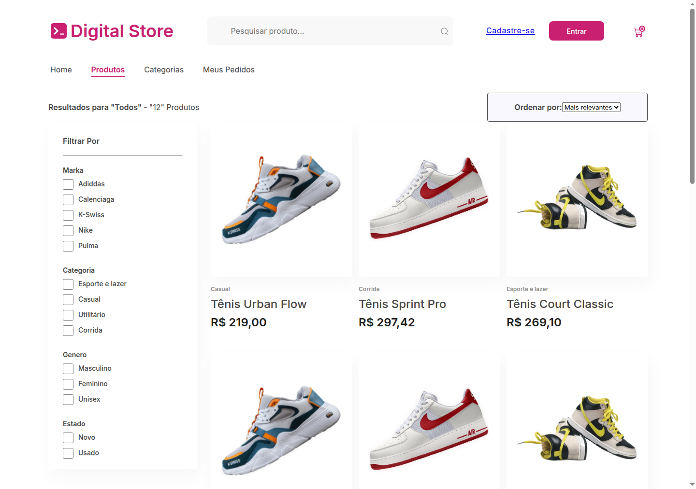
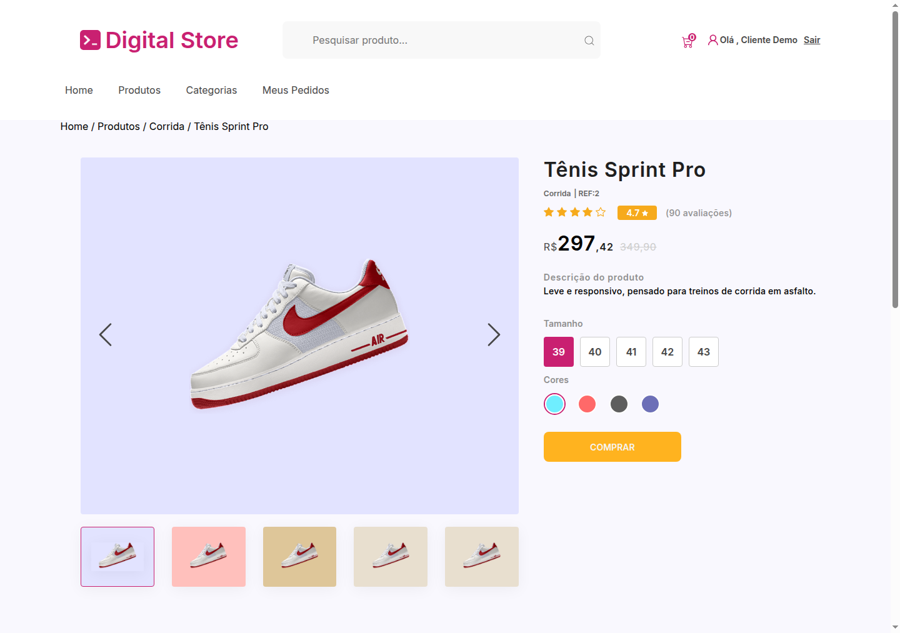
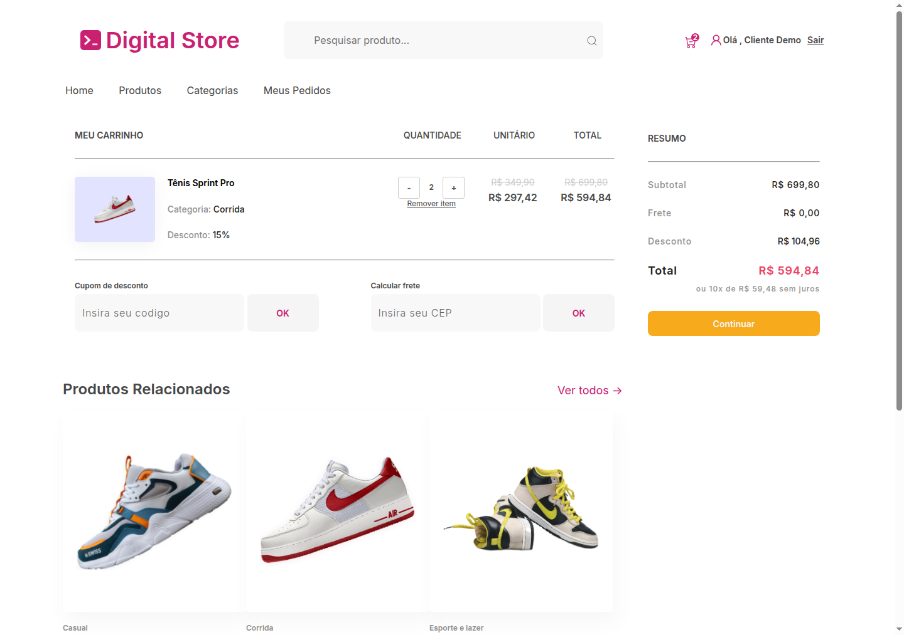

# Digital Store — Full Stack E-commerce (Digital College)

An educational e-commerce storefront built as a team project in the Full Stack course at
Digital College (Fortaleza, Brazil). A React single-page application
consumes a Node.js/Express REST API with JWT authentication. Both sides are written in TypeScript.

The frontend and the backend were originally developed in two separate repositories. This monorepo
brings them together, connects the main user flows to the API and fixes the security problems found
in the original code.

> **Scope.** This is a learning project, not a production platform. There is no payment processing,
> and data is persisted in JSON files. See [Known limitations](#known-limitations).



| Product page | Cart |
| --- | --- |
|  |  |

## Features

**Connected to the API**

- Product catalogue on the home page and on the product listing, with search by title, description and category
- Product detail page
- Sign-up and login against the API (passwords hashed with bcrypt, session kept with a JWT)
- Session restored on page reload, and logout
- Per-user shopping cart: add a product, change quantities, remove items, empty the cart — totals are
  calculated by the API from catalogue prices
- Loading and error states for API calls

**Layout only (static, as designed in the course)**

- Checkout and "demonstration completed" pages — both are labelled as a demonstration, no personal,
  delivery or card data is requested, nothing is sent, charged or stored; only the order summary
  shows real cart values
- "Meus Pedidos" (order history) and "Minhas Informações" pages
- Filter sidebar and "sort by" selector on the product listing
- Coupon and shipping fields, size and colour pickers, star ratings
- "Login with Gmail/Facebook" icons and "Esqueci minha senha"

## Tech stack

| Layer | Technologies |
| --- | --- |
| Frontend | React 18, TypeScript (strict mode), React Router 6, Sass (CSS Modules), Vite |
| Backend | Node.js, TypeScript (strict mode, CommonJS output), Express 4, jsonwebtoken, bcrypt, cors, dotenv |
| Persistence | JSON files on disk |
| Tests | `node:test` + Supertest, run through `tsx` (API), Vitest + React Testing Library (frontend) |

## Repository structure

```text
.
├── backend/
│   ├── src/
│   │   ├── server.ts        # HTTP server entry point
│   │   ├── app.ts           # Express app: CORS, routes, JSON error handler
│   │   ├── config.ts        # environment variables (fails fast without JWT_SECRET)
│   │   ├── types/           # entities, API responses, Express request augmentation
│   │   ├── lib/             # JSON file store, record validation, HTTP helpers
│   │   ├── middleware/      # JWT authentication and admin check
│   │   └── routes/          # produtos, userauth, users, carrinho
│   ├── test/                # API tests (TypeScript)
│   ├── data/seed/           # fictional demo data (versioned)
│   ├── public/imagens/      # demo product images
│   ├── dist/                # compiled JavaScript (generated, git-ignored)
│   ├── tsconfig.json        # type-check configuration (src + test)
│   └── tsconfig.build.json  # build configuration (src -> dist)
├── frontend/
│   ├── src/
│   │   ├── types/           # API contracts (products, user, login, cart) and form models
│   │   ├── services/        # API client and runtime validation of API responses
│   │   ├── contexts/        # AuthContext, CartContext, SearchContext (providers + hooks)
│   │   ├── hooks/           # useProdutos, useProduto
│   │   ├── utils/           # price formatting and discount calculation
│   │   ├── routes/          # navigation links
│   │   ├── pages/           # Home, Produtos, Login, Cadastro, Compra, MeusPedidos
│   │   ├── components/      # one folder per component (index.tsx + styles.module.scss)
│   │   ├── testes/          # fake API shared by the tests
│   │   └── App.test.tsx     # frontend integration tests
│   ├── public/              # static files copied as-is (favicon, manifest, icons)
│   ├── index.html           # HTML entry point
│   ├── vite.config.ts       # dev server, /api proxy, build and Vitest configuration
│   ├── eslint.config.js     # ESLint flat config
│   ├── tsconfig.json        # strict type-check configuration (src)
│   └── tsconfig.node.json   # type-check configuration for vite.config.ts
├── docs/screenshots/
├── scripts/setup-env.js     # creates .env with a random JWT secret
├── .env.example
└── package.json             # root scripts
```

## Architecture

```text
Browser ── React SPA (localhost:3000)
              │  fetch + "Authorization: Bearer <JWT>"
              │  development: /api/* → Vite proxy; production build: API URL directly
              ▼
        Express API (localhost:3001)
              │  CORS allow-list → JSON body → routes
              │  isAuthenticated (JWT) → isAdmin / ownership checks
              ▼
        JSON file store (backend/data/*.json, created from data/seed)
```

- The API is stateless: the JWT only carries the user id, and the user (and role) is re-read from the
  store on every authenticated request.
- A cart belongs to the authenticated user. Cart routes never take a cart or user id from the client,
  and prices always come from the catalogue.
- The frontend keeps the logged-in user, the cart and the search term in React contexts
  (`frontend/src/contexts`); the token is kept in `localStorage`.
- The frontend declares the API contracts as TypeScript types and checks every API response against
  them at runtime before the data reaches a component.

The full endpoint reference is in [backend/README.md](backend/README.md).

## Getting started

Requirements: npm and Node.js 20.19+ or 22.12+, the versions Vite 7 supports (developed and tested
only on Node.js 24).

The backend is TypeScript. In development it runs straight from the sources with `tsx`; for
production-style execution it is compiled to `backend/dist` and started with plain Node.js. The
frontend is served and bundled by Vite; `tsc` is used only for type checking, and the frontend build
runs it before bundling.

```bash
npm run install:all   # installs root, backend and frontend dependencies
npm run setup         # creates .env from .env.example with a random JWT_SECRET
npm run dev           # API on http://localhost:3001, frontend on http://localhost:3000
```

Then open <http://localhost:3000>.

To run the compiled API instead of the development server:

```bash
npm run build:backend   # tsc: backend/src -> backend/dist
npm --prefix backend start
```

### Environment variables

Backend variables live in a `.env` file at the repository root (never committed):

| Variable | Default | Description |
| --- | --- | --- |
| `JWT_SECRET` | — (required) | Token signing secret, at least 32 characters. The API refuses to start without it. |
| `PORT` | `3001` | API port |
| `JWT_EXPIRES_IN` | `1h` | Token lifetime, as a duration such as `15m`, `1h` or `7d`. The API refuses to start with an invalid value. |
| `SALT_HASH` | `10` | bcrypt cost factor |
| `CORS_ORIGIN` | `http://localhost:3000` | Comma-separated list of allowed origins |

Frontend variables are optional and go in `frontend/.env` — see
[frontend/.env.example](frontend/.env.example):

| Variable | Default | Description |
| --- | --- | --- |
| `VITE_API_URL` | empty | API base URL. When empty, the development server sends requests to `/api`, which it proxies to the API, and a production build uses `http://localhost:3001`. Set it for any deployed build. It is embedded in the bundle, so it must never hold a secret. |
| `API_PROXY_TARGET` | `http://localhost:3001` | Where the development server proxies `/api`. Read only by `vite.config.ts`; never sent to the browser. |

In development the browser only talks to `localhost:3000`, so CORS is not involved. A production
build calls the API directly, so its origin must be listed in `CORS_ORIGIN`. `npm run
preview:frontend` serves the build on port 3000, which the default `CORS_ORIGIN` already allows.

### Demo accounts

The seed data contains two **fictional** accounts so the application can be explored right away:

| Role | E-mail | Password |
| --- | --- | --- |
| Customer | `cliente@digitalstore.example` | `cliente-demo-123` |
| Admin | `admin@digitalstore.example` | `admin-demo-123` |

These credentials are public. Remove the accounts from `backend/data/seed/users.json` (or change their
passwords) before exposing the API anywhere other than your own machine.

The admin role is only used by the API (creating, updating and deleting products); there is no admin
screen in the frontend.

### Resetting the data

Runtime data is written to `backend/data/*.json`, which is git-ignored. Delete those files to go back
to the seed data.

## Scripts

Run from the repository root:

| Command | What it does |
| --- | --- |
| `npm run install:all` | Installs all dependencies |
| `npm run setup` | Creates `.env` (does not overwrite an existing one) |
| `npm run dev` | Starts API and frontend together, with reload |
| `npm run start:backend` | Compiles the API and starts the compiled JavaScript |
| `npm run start:frontend` | Starts the frontend development server (Vite) |
| `npm run preview:frontend` | Serves the frontend production build on port 3000 |
| `npm run typecheck` | Type-checks backend and frontend sources and tests (`tsc --noEmit`) |
| `npm run typecheck:backend` / `npm run typecheck:frontend` | Type-checks one of them |
| `npm run lint` | Lints the frontend (ESLint, TypeScript, React hooks and accessibility rules), failing on any warning |
| `npm test` | Runs backend and frontend tests |
| `npm run test:backend` / `npm run test:frontend` | Runs one suite |
| `npm run build` | Builds the backend (`backend/dist`) and the frontend (`frontend/build`, type-checked first) |
| `npm run build:backend` / `npm run build:frontend` | Builds one of them |
| `npm run validate` | Type checks, frontend lint, tests, then both builds |

Backend-only scripts are listed in [backend/README.md](backend/README.md) and frontend-only scripts
in [frontend/README.md](frontend/README.md).

## Tests

```bash
npm test
```

- **Backend** (`backend/test`): sign-up, login with valid and invalid credentials, JWT verification
  (tampered, expired, wrong secret, unsigned, deleted account), blocked unauthenticated and
  non-admin access, product queries, input validation, JSON error responses, CORS, cart ownership and
  concurrent writes, seed copying, stored-record validation and the on-disk file format. The tests
  are written in TypeScript, use a temporary data directory and their own secret, so they never
  touch local data.
- **Frontend** (`frontend/src/**/*.test.ts(x)`), written in TypeScript and run by Vitest in jsdom:
  - `App.test.tsx` renders the whole application and replaces only `fetch` with a typed fake API
    that follows the backend contracts — product listing, search and empty results, API failure and
    out-of-contract responses, product page, login (invalid and valid), session restore, rejected
    tokens and logout, sign-up (success without any consent checkbox, validation and duplicate
    e-mail), the cart (add, change quantity, remove, empty, API errors and expired session), the
    product gallery (mouse and keyboard) and the demonstration checkout (no personal, delivery or
    card fields, no API calls).
  - Unit tests cover response validation, the HTTP client (headers, error mapping, token storage),
    the price helpers and the context hooks.

## Security notes

Changes made to the original code when the two projects were merged:

- Passwords are stored only as bcrypt hashes and never returned by the API (the original had a second
  user store in plain text, exposed by an unauthenticated route).
- The JWT middleware now stops unauthorized requests (it used to answer with an error and still call
  the next handler). Tokens are verified with a fixed algorithm.
- All uses of `eval()` were removed (backend and frontend).
- Product write routes require an admin; user routes require the account owner or an admin; cart
  routes require authentication and are scoped to the token's user.
- Request bodies are validated and only known fields are copied (the original merged the whole body
  into stored records).
- CORS is restricted to an allow-list, and errors are returned as JSON without internal details.
- Secrets come only from environment variables; the server does not start without `JWT_SECRET`.
- The sign-up form shows CPF, phone and address fields from the original design, but only name,
  e-mail and password are sent to the API.

## Known limitations

- **JSON file persistence.** Writes are atomic (temporary file + rename) and serialized per file, but
  only inside a single Node.js process. Running more than one instance would lose updates. There are
  no transactions across files, no backups, and on hosts with an ephemeral filesystem the data is
  lost on every restart or deploy. Every request reads whole files, so it does not scale.
- **Token storage.** The JWT is kept in `localStorage`, which a cross-site scripting flaw could read.
  There is no refresh token and no server-side revocation: a token stays valid until it expires
  (1 hour) or the account is deleted.
- **Stored data is validated, not migrated.** Every read checks the JSON files against the
  TypeScript models; a file edited by hand into an unexpected shape makes the affected routes answer
  `500` until it is fixed or deleted.
- **Contracts are duplicated, not shared.** The frontend declares its own copy of the API types
  (`frontend/src/types`) instead of importing the backend ones, to keep the two packages
  independent. Runtime validation in the frontend catches a mismatch as an error message, but
  nothing fails at compile time if the two copies drift apart.
- **Different compilers.** The frontend uses TypeScript 5.9 and the backend TypeScript 7, because
  `typescript-eslint`, used to lint the frontend, supports TypeScript only up to 6.0.
- **No rate limiting** on login or sign-up, no e-mail verification and no password recovery.
- **No HTTPS or security headers** are configured by the application; a deployment would need them.
- **No orders or payments.** Checkout is a demonstration: it asks for no personal, delivery or card
  data, sends nothing, and the cart is not converted into an order.
- **One image per product.** The gallery on the product page repeats the same image; its arrows and
  thumbnails only switch the selected thumbnail and the background colour.
- **No marketing preference or terms of use.** The newsletter checkbox of the original sign-up form
  was removed, because the API has nowhere to store that choice, and the project has no terms of use
  or privacy policy document to be accepted.
- The sign-up form still requires every field it shows, including the ones that are not sent to the
  API.
- `npm audit` reports advisories in two runtime dependencies kept at their current versions:
  `react-router-dom` 6.4.3 (fixed in later 6.x releases) and `better-react-carousel`, which pulls in
  old `lodash` and `picomatch` copies and is only used by the unrendered `Banner` component.
- **Accessibility was improved, not audited.** Links, buttons, form field names and image
  alternatives were fixed in the main flows and the product gallery is keyboard-operable, but no
  screen reader testing was done.
- Interface texts and API messages are in Portuguese.

## Credits

Developed by students of the Full Stack course at Digital College. Design based on the course's
"Drip Store" Figma project. Product and banner images are the assets of the original course project
and are used for educational purposes only.

Original repositories:
[DarlanMendes/digital-store](https://github.com/DarlanMendes/digital-store) (frontend) and
[daviroquedev/backend-dc](https://github.com/daviroquedev/backend-dc) (backend).

Team, as listed in the original READMEs:

- Davi Roque — [@daviroquedev](https://github.com/daviroquedev)
- Lucas Monteiro — [@LMsousa20](https://github.com/LMsousa20)
- Darlan Mendes — [@DarlanMendes](https://github.com/DarlanMendes)
- Emerson Souza — [@SouEmersonSouza](https://github.com/SouEmersonSouza)
- José Antonio — [@JoseAAntonio](https://github.com/JoseAAntonio)
- Antonio Rodrigues — [@BigTonny1980](https://github.com/BigTonny1980)
- Matheus Freire — [@Matheus-TecDev](https://github.com/Matheus-TecDev)
- Ivan Praciano
- Nivea Natalia — [@nivea-natalia](https://github.com/nivea-natalia)
- Andre Soares — [@andresoaresmota](https://github.com/andresoaresmota)
- Jorge Silva — [@jorge-sillva](https://github.com/jorge-sillva)
- Emanuel

Monorepo unification, API integration, security fixes, tests and the backend and frontend migrations
to TypeScript by Matheus Freire.
